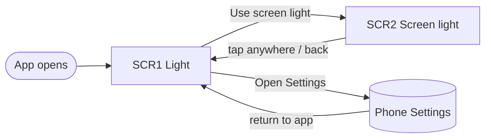

# 03 · UX flows: Flashlight

*Plain English: every screen, every state it can be in, and what happens step by step, including when things go wrong.*

`Feature: Flashlight | Platform: mobile app (iOS + Android) | Version: 1 | Date: 2026-11-16 | Status: draft`

## Navigation map

Two screens only. No menus, tabs or settings in v1.

## Screen inventory
| Screen | Purpose | Entry points | Main action | Stories |
|---|---|---|---|---|
| SCR1 Light | Turn the torch on and off; show its true state; route to the screen light when the torch can't be used | App launch; return from background; closing SCR2 | Tap the main button | US1–US5 |
| SCR2 Screen light | Full-screen white light | "Use screen light" on SCR1 | Tap anywhere to close | US3 |

**SCR1 layout:** a dark, calm background. One large circular button in the centre (≥ 50% of screen width) with a torch icon and a text label below it. A short status line under the button. Secondary buttons (when present) sit below the status line. Nothing else on screen.

## State matrix

### SCR1 Light
| State | When | What the user sees | What they can do | Copy |
|---|---|---|---|---|
| **off** (default) | Torch available and off | Button outlined, icon dimmed | Tap button → on | Label: "Turn light on" · Status: "Light is off" |
| **turning on** | Between tap and confirmation (≤ 500 ms) | Button pressed state; no spinner unless > 300 ms | Wait (extra taps follow AC1.5) | n/a |
| **on** | Torch confirmed on | Button filled with warm yellow glow, icon bright | Tap button → off | Label: "Turn light off" · Status: "Light is on" · Screen reader: "Light on" |
| **permission needed** | First tap, and the platform needs permission [Assumption, OQ2] | Explanation card replaces the status line | "Continue" → system prompt · "Use screen light instead" | Title: "One quick permission" · Body: "Your phone controls its flashlight through the camera, so it asks for camera access. We never take photos or video, and nothing leaves your phone." · Button: "Continue" |
| **permission denied** | User refused, or revoked in Settings | Button greyed out, not tappable | "Use screen light" · "Open Settings" | Status: "Flashlight access is turned off" · Body: "You can use your screen as a light, or turn access back on in Settings." |
| **unavailable** | Device has no torch | No toggle button; screen-light button takes its place, same size | "Use screen light" | Status: "No flashlight on this device" · Body: "Your screen can light things up instead." |
| **error: busy** | Torch in use by another app | Button stays off | "Try again" · "Use screen light" | "Another app is using the flashlight. Close it and try again." |
| **error: too hot / low power** | System has disabled the torch | Button stays off | "Try again" · "Use screen light" | "Your phone has turned the flashlight off for now, usually because it's too hot or the battery is low. Try again in a few minutes." |
| **error: unknown** | Any other failure | Button stays off | "Try again" · "Use screen light" | "The flashlight didn't turn on. Try again, or use your screen as a light." |
| **turned off while away** | Returned to app and the platform had turned the torch off (AC4.3) | Off state + temporary hint for 3 s | Same as off | Hint: "Your phone turned the light off when you left the app" |

### SCR2 Screen light
| State | When | What the user sees | What they can do | Copy |
|---|---|---|---|---|
| **on** | Opened from SCR1 | Whole screen white, max brightness, status bar hidden | Tap anywhere or back → close | Small dark-grey hint (contrast ≥ 4.5:1 on white) at bottom for 3 s, then fades: "Tap anywhere to close" |
| **on, brightness locked** | App can't change brightness (OQ3) | White screen + hint for 3 s | Same | "Turn up your screen brightness for more light" |

## Flows

### FL1 · First use (permission needed) · US1, US5
1. User opens the app → SCR1 shows **off** within 1.5 s (NFR2). No permission is asked at launch (AC5.4).
2. User taps the main button → if permission is needed, SCR1 shows **permission needed** (AC5.5).
3. User taps "Continue" → the system permission prompt appears.
4. User allows → torch turns on within 500 ms → SCR1 **on**, haptic tap, "Light on" announced (AC1.1–AC1.3).
5. User taps the button → torch off → SCR1 **off** (AC2.1–AC2.2).

*If no permission is needed on the platform (OQ2), steps 2–3 are skipped.*

### FL2 · Everyday use · US1, US2
1. User opens the app → SCR1 **off**.
2. Taps the button → **on** (AC1.1–AC1.3).
3. Taps again → **off** (AC2.1–AC2.2).

### FL3 · Screen light · US3
1. From SCR1 (**unavailable**, **permission denied** or any **error** state), user taps "Use screen light" → SCR2 **on**: white, max brightness, screen kept awake (AC3.4).
2. User taps anywhere → SCR2 closes within 300 ms → previous brightness restored → back to SCR1 in its previous state (AC3.5).

### FL4 · Leaving and returning · US4
1. Torch **on**, user switches app or locks the phone.
2. If the platform keeps the torch on, it stays on (AC4.3).
3. User returns → SCR1 shows the true state within 300 ms (AC4.2). If the platform turned it off: **turned off while away** hint (AC4.3).

## Failure flows
| ID | Trigger | System behaviour | User feedback | Recovery | Can continue? |
|---|---|---|---|---|---|
| FF1 | User refuses permission (or revokes it later) | Torch stays off; button disabled (AC3.2) | **permission denied** state | "Use screen light" (FL3) or "Open Settings". On return from Settings, the app re-checks permission; if now granted, show **off** (EC9) | Yes, via screen light |
| FF2 | Torch busy (another app) | Torch stays off (AC3.3) | **error: busy** | "Try again" re-attempts once per tap; "Use screen light" | Yes |
| FF3 | Torch disabled by system (heat / low power) | Torch stays off (AC3.3) | **error: too hot / low power** | "Try again" later; "Use screen light" | Yes |
| FF4 | Platform turns torch off when app leaves foreground | State re-read on return (AC4.2, AC4.3) | **turned off while away** hint | Tap to turn on again | Yes |
| FF5 | Torch turned off from Control Center / Quick Settings while app open | State updates within 1 s (AC4.1) | Button switches to **off** | Tap to turn on again | Yes |
| FF6 | Unknown error turning torch on/off | Button stays in last confirmed state (AC3.3) | **error: unknown** | "Try again"; "Use screen light" | Yes |

## Interactions and validation
- No text inputs; nothing to validate.
- **Main button:** single tap toggles. Long press does nothing in v1. Double-tap is treated as two taps (AC1.5).
- **Haptics:** one light tap on each successful on/off change only; none on errors. Respect the system setting if haptics are turned off.
- **Screen light:** any tap closes it. No swipe gestures.

## Key microcopy
| Where | Text |
|---|---|
| Button (off) | Turn light on |
| Button (on) | Turn light off |
| Status (off / on) | Light is off / Light is on |
| Screen light button | Use screen light |
| Settings button | Open Settings |
| Retry button | Try again |
| Permission explainer | See SCR1 **permission needed** |
| Store listing promise | "One tap for light. No ads, no account, no data collected." |

Tone: short, calm, says what to do next. Never blame the user.

## Behavioural design notes
- **One target, zero decisions:** the whole screen is essentially one button. People reach for a flashlight under stress or half-asleep; removing choice reduces effort and errors (Fogg: ability).
- **Big, thumb-reachable target:** in the dark, people tap imprecisely; a large central target makes success near-certain.
- **Multi-channel feedback:** colour change, label change, haptic tap and screen-reader announcement confirm the outcome, so there's no uncertainty about whether it worked (JS3).
- **Permission asked in context, explained first:** asking at the moment of need, with a reason, makes the request make sense and increases acceptance; asking at launch feels intrusive.
- **A way forward from every dead end:** every failure state offers the screen light, so the goal (light) is always reachable.
- **Trust made visible:** "No ads, no account, no data collected" in the store listing addresses a known reason people avoid flashlight apps.

## Platform notes (mobile app)
- **Gestures:** tap only. On Android, the system back button or gesture closes SCR2; on iOS, a tap anywhere closes it.
- **Push notifications:** none. Never ask for notification permission.
- **Permissions:** request only the permission the platform needs for the torch, at first tap, after the explainer (OQ2). iOS needs a camera usage description string if camera permission is used: "Your phone controls its flashlight through the camera. We never take photos or video."
- **Offline:** fully offline; no sync.
- **Backgrounded or killed:** see FL4 and AC4.3–AC4.4. On return, always re-read torch state and permission status.
- **Orientation:** portrait only in v1. [Assumption]
- **Store requirements:** privacy labels "Data Not Collected" (App Store) and "No data collected" (Google Play Data safety). No account, so no in-app account deletion needed. Do not describe or include strobe effects in store listings.
