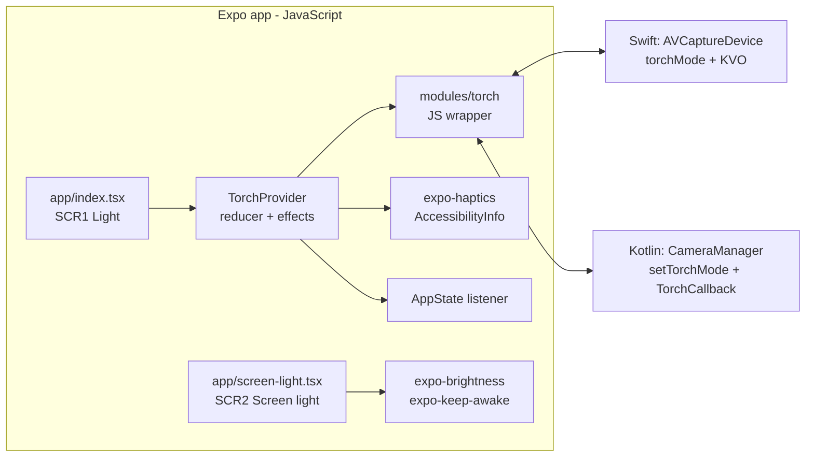

# 04 · Tech spec: Flashlight

*Plain English: how the app is built, what each part does, and how we prove it meets 01–03.*

`Feature: Flashlight | Platform: mobile app (iOS + Android) | Version: 1 | Date: 2026-11-16 | Status: draft`

## 1. Overview

A two-screen Expo (React Native) app: **SCR1 Light** toggles the phone's torch and always shows its true state; **SCR2 Screen light** is a full-screen white fallback. The torch is driven by a small in-repo native module (Swift + Kotlin) because no stock Expo module both controls the torch without a camera session *and* reports torch changes made outside the app (AC4.1). There is no backend, no account, no analytics and no network access. Inputs: [01-prd.md](01-prd.md), [02-requirements.md](02-requirements.md), [03-ux-flows.md](03-ux-flows.md).

## 2. Stack and decisions

Branch B (mobile). Versions checked on npm on 2026-11-16; at scaffold time, install Expo packages with `npx expo install` so they match the SDK, and record the resolved versions here.

| Layer | Choice | Version |
|---|---|---|
| Framework | Expo managed workflow + dev build, React Native, TypeScript strict | Expo SDK 58 (`expo` 58.0.25), RN 0.88, React 19.3, TS 7.0 |
| Navigation | Expo Router (2 routes: `index`, `screen-light`) | 58.0.x |
| UI | React Native `StyleSheet` + one `theme.ts` | n/a |
| Local state | `useReducer` + React context (one reducer, pure) | n/a |
| Torch | In-repo Expo Module `modules/torch` (Swift `AVCaptureDevice`, Kotlin `CameraManager`) | expo-modules-core 58.1.x |
| Device features | `expo-brightness`, `expo-keep-awake`, `expo-haptics`, `expo-status-bar`; RN `AccessibilityInfo`, `AppState`, `Linking`, `BackHandler` | 58.0.x |
| Testing | Jest (`jest-expo`) + React Native Testing Library; Maestro for flows on device | jest-expo 58.0.x, RNTL 14.1, Maestro latest |
| Quality | ESLint (`eslint-config-expo`), Prettier 3.10, `tsc --noEmit`, GitHub Actions CI | |
| Build and release | EAS Build, EAS Submit | eas-cli 27.x |
| Package manager | pnpm | |

**Not used, on purpose:** Supabase, TanStack Query, Zustand, React Hook Form/Zod, NativeWind, Sentry, EAS Update.

### Decisions
- **D1 No backend (Supabase dropped).** Why: the app stores and sends nothing (AC5.1, NFR4); no accounts (AC5.3). Rejected: default Supabase backend.
- **D2 No Sentry, no analytics.** Why: both send data off the phone, breaking AC5.1/AC5.2 and the "Data Not Collected" labels. Crash data comes from App Store Connect / Play Console (NFR5–NFR6). Rejected: default Sentry.
- **D3 No EAS Update (over-the-air updates).** Why: it makes network requests on launch (AC5.1). Fixes ship as store builds. Rejected: default EAS Update.
- **D4 In-repo native torch module.** Why: needs (a) on/off without a running camera preview, (b) an event when the torch changes outside the app (AC4.1, EC4), (c) clear error causes (AC3.3). Android `CameraManager.setTorchMode` + `TorchCallback` and iOS `AVCaptureDevice.torchMode` + key-value observation give all three in ~150 lines per platform. Rejected: `expo-camera`'s `enableTorch` (needs camera permission and a live camera view, no external-change events); third-party torch packages (extra dependency to audit for AC5.2, and none confirmed to report external changes).
- **D5 `useReducer` instead of Zustand.** Why: one screen of state; a pure reducer is easier to unit-test (AC1.5) and keeps the codebase small (PRD §7). Rejected: Zustand.
- **D6 `StyleSheet` instead of NativeWind.** Why: two screens; avoids a Babel/Tailwind toolchain. Rejected: NativeWind.
- **D7 Block network permission on Android release builds.** Why: makes AC5.1 enforceable, not just promised. `app.config.ts` reads `APP_VARIANT` (set per profile in `eas.json`: `development` | `preview` | `production`) and adds `"android.permission.INTERNET"` to `android.blockedPermissions` unless the variant is `development` (dev builds need it for the Metro bundler). Fallback if a release build fails without it: keep the permission and rely on the AC5.1 network-monitor check alone.
- **D8 Portrait only**, per 03 platform notes (`orientation: "portrait"`).
- **D9 Permission screens built behind a capability flag.** Why: OQ2 is unresolved. The native module reports `permissionRequired: boolean` per platform; if false (expected: neither API needs camera permission for the torch alone), SCR1 never shows **permission needed/denied** and no iOS camera usage string or Android `CAMERA` permission is added. The states are still built and unit-tested so that a "yes" from the spike costs no rework.

## 3. Architecture



No servers. Nothing leaves the phone.

```
app/
  _layout.tsx           Router stack, TorchProvider, StatusBar
  index.tsx             SCR1 Light
  screen-light.tsx      SCR2 Screen light (modal, status bar hidden)
src/
  torch/
    reducer.ts          pure state machine (all SCR1 states)
    reducer.test.ts
    TorchProvider.tsx   wires reducer to native module, AppState, haptics, announcements
    copy.ts             all user-facing text from 03 (one place)
  components/
    MainButton.tsx      big round toggle
    StatusArea.tsx      status line, body text, secondary buttons, timed hints
    Hint.tsx            3 s auto-hiding hint (respects reduce motion)
  theme.ts              colours, sizes, contrast-checked pairs
modules/torch/
  index.ts              typed JS API (below)
  ios/TorchModule.swift
  android/src/main/java/.../TorchModule.kt
  __mocks__/index.ts    fake used by Jest
e2e/                    Maestro flows (*.yaml)
scripts/audit-deps.mjs  fails if a banned SDK is in the dependency tree
```

**Where logic lives:** all decisions (what state to show, which error, rapid-tap handling) are in `reducer.ts` (pure, tested). `TorchProvider` performs side effects. Native code only talks to the hardware and maps platform errors to the error codes below.

## 4. Data model

None. The app stores no data: no database, no files, no `AsyncStorage`. The only remembered value is the user's screen brightness, held in memory while SCR2 is open. (Template sections ER diagram, RLS and seed data: not applicable.)

## 5. Operations (native module API)

No server operations. The torch module is the app's only "API":

| ID | Call | Input | Output | Errors | Serves |
|---|---|---|---|---|---|
| O1 | `getCapabilities()` | none | `{ hasTorch: boolean, permissionRequired: boolean }` | none | AC3.1, AC5.4, D9 |
| O2 | `getState()` | none | `{ on: boolean, available: boolean, permission: 'granted' \| 'denied' \| 'undetermined' \| 'notRequired' }` | none | AC4.1, AC4.2, FF1, EC9 |
| O3 | `setTorch(on)` | `on: boolean` | resolves `{ on }` once the hardware confirms | rejects with `code`: `BUSY`, `UNAVAILABLE` (too hot / low power / system disabled), `NO_TORCH`, `PERMISSION_DENIED`, `UNKNOWN` | AC1.1, AC2.1, AC3.3 |
| O4 | `requestPermission()` | none | `'granted' \| 'denied'` (resolves `'granted'` immediately when not required) | none | AC5.4, AC5.5 |
| O5 | event `onTorchChange` | n/a | `{ on: boolean, available: boolean }` | n/a | AC4.1, FF5, EC4 |

**Error mapping:** Android `CameraAccessException.CAMERA_IN_USE`/`MAX_CAMERAS_IN_USE` → `BUSY`; `CAMERA_DISABLED` or `TorchCallback.onTorchModeUnavailable` → `UNAVAILABLE`; anything else → `UNKNOWN`. iOS `lockForConfiguration` failure → `BUSY`; `isTorchAvailable == false` → `UNAVAILABLE`; `setTorchModeOn` throws → `UNKNOWN`. Mapping is confirmed or corrected in spike S1.

## 6. Auth and permissions

No sign-in, no roles (AC5.3). Device permissions: none expected; camera only if spike S1 proves a platform needs it (D9), requested only from the explainer card after the first tap (AC5.4, AC5.5). Never: notifications, location, network-dependent permissions.

## 7. Client state and data flow

`TorchState` (reducer) holds:
- `status`: `off | turningOn | turningOff | on | permissionNeeded | permissionDenied | unavailable | errorBusy | errorUnavailable | errorUnknown`
- `desired: boolean | null`: the target from the latest tap (AC1.5)
- `hint: 'turnedOffWhileAway' | null`
- `wasOnWhenLeft: boolean`

**Rapid taps (AC1.5):** each tap flips `desired`. Only one `setTorch` call runs at a time; when it settles, if `desired` differs from the confirmed state, one more call is made. Taps in between only update `desired`, so the torch ends at the last tap's state with at most one extra switch.

**Spinner:** `turningOn` shows the pressed state; a spinner appears only if confirmation takes > 300 ms (03).

**Truth source:** the UI shows a confirmed state, never an assumed one. `onTorchChange` events and `getState()` on every `AppState → active` overwrite the state (AC4.1, AC4.2). On `active`, if `wasOnWhenLeft && !on` **and** spike S1 found that this platform turns the torch off when the app leaves the foreground (`osTurnsOffInBackground`, a per-platform constant recorded from S1), set `hint = turnedOffWhileAway` for 3 s (AC4.3). If the platform keeps the torch on, "off" on return means the user switched it off somewhere else, so no hint is shown, because the hint's copy says the phone did it.

**Feedback (on every confirmed on/off change, including changes made from Control Center / Quick Settings while the app is open, since 03 says "each successful on/off change"):** a light haptic, skipped on errors; `AccessibilityInfo.announceForAccessibility('Light on' | 'Light off')`. Haptics: iOS `Haptics.impactAsync(Light)` (iOS honours the system haptics setting); Android `Haptics.performAndroidHapticsAsync` with a standard feedback type, which honours the system touch-feedback setting (plain `impactAsync` vibrates regardless).

**SCR2:** on mount, save `getBrightnessAsync()`, `setBrightnessAsync(1)`, `activateKeepAwakeAsync()`. If setting brightness throws, show "Turn up your screen brightness for more light" for 3 s (AC3.4). On unmount, or `AppState → background`, restore the saved brightness and `deactivateKeepAwake()` (AC3.5, AC3.6). On returning to the foreground with SCR2 still open, re-apply max brightness. Android back gesture closes the route (Expo Router default).

**Offline:** everything is local (NFR8).

## 8. Error handling

| Case | Detected by | System does | User sees | Logged | Recovery |
|---|---|---|---|---|---|
| EC1 No torch | O1 `hasTorch=false` at launch | Never render toggle | SCR1 **unavailable** | No | "Use screen light" → SCR2 |
| EC2 / FF2 Torch busy | O3 rejects `BUSY` | Stay off | SCR1 **error: busy** | No | "Try again" (one attempt per tap), "Use screen light" |
| EC3 / FF3 Too hot / low power | O3 rejects `UNAVAILABLE`, or O5 `available=false` | Stay off | SCR1 **error: too hot / low power** | No | "Try again", "Use screen light" |
| EC4 / FF5 Changed in Control Center / Quick Settings | O5 event | Update state ≤ 1 s | SCR1 **on**/**off** | No | Tap to toggle |
| EC5 / FF4 Backgrounded or locked with torch on | `AppState` + O2 on return | Leave on if the OS allows; re-read on return ≤ 300 ms | SCR1 **on**, or **turned off while away** hint 3 s | No | Tap to turn on |
| EC6 Rapid taps | Reducer `desired` | Serialise calls (§7) | Final state matches last tap | No | n/a |
| EC7 Screen light open when backgrounded | `AppState` in SCR2 | Restore brightness, release keep-awake | n/a (on return, max brightness re-applied) | No | n/a |
| EC8 / FF1 Permission refused or revoked (only if D9 flag true) | O4 `denied` / O2 on return | Disable toggle | SCR1 **permission denied** | No | "Use screen light", "Open Settings" (`Linking.openSettings()`) |
| EC9 Permission granted later in Settings | O2 on `active` | Clear denied state | SCR1 **off** | No | Tap to turn on |
| FF6 Unknown error on/off | O3 rejects `UNKNOWN` | Keep last confirmed state | SCR1 **error: unknown** when turning on; when turning off, the **on** state plus an error line (copy pending, open question Q1 in §12) | No | "Try again", "Use screen light" |
| App swiped away (AC4.4) | OS | Best effort: native module turns the torch off in `OnDestroy` (Android) / `applicationWillTerminate` (iOS). Neither is guaranteed (iOS skips it for suspended apps; Android skips it when the process is killed), so the real behaviour is what T1.5 measures on device. If the torch survives, the app shows the true state on next open (AC4.1, AC4.2). | n/a | No | n/a |

"Logged: No" everywhere because the app collects no data (NFR4). Crashes reach the stores' own reports.

## 9. Non-functional requirements

| NFR | How it's met | How it's checked |
|---|---|---|
| NFR1 Speed ≤ 500 ms | Direct native call, no camera session; no JS work between tap and call | Dev build logs `tap → confirmed` ms; device checklist on a mid-range iPhone and Android, 10 taps each, all ≤ 500 ms |
| NFR2 Start-up ≤ 1.5 s | Two screens, no fonts/images to load, no network | Cold-start timing on the same devices (stopwatch from tap to interactive, or Android `adb shell am start -W`) |
| NFR3 Accessibility WCAG 2.2 AA | `accessibilityRole="button"`, label = current button text, `accessibilityState`; announcements (§7); main button ≥ 50% width; every secondary button ("Try again", "Use screen light", "Open Settings", "Continue") min height and width 48 (pt on iOS, dp on Android, covering both 44 pt and 48 dp); contrast pairs in `theme.ts` with a unit test computing ratio ≥ 4.5:1 (incl. dark-grey hint on white); text uses system font scaling, layout in a `ScrollView` so largest sizes don't clip; dark background in both system themes (contrast tested for each); `AccessibilityInfo.isReduceMotionEnabled` → no fades > 200 ms | Unit test for contrast; RNTL tests for labels/roles; manual VoiceOver + TalkBack pass; screenshots at largest text size |
| NFR4 Privacy | D1–D3, D7; no storage | `scripts/audit-deps.mjs` in CI; network monitor run (AC5.1); store labels set |
| NFR5 Measurement | No in-app events | Audit script; store consoles after launch |
| NFR6 Reliability | State only from confirmed hardware state + events | Reducer tests; device checklist EC4 |
| NFR7 Battery | No background tasks; keep-awake only in SCR2 | Code review: `activateKeepAwake` only in `screen-light.tsx`; RNTL test that it is released on unmount |
| NFR8 Offline | No network code | Run FL1–FL3 in airplane mode |

**Analytics events:** none (NFR5). **Error monitoring:** store consoles only (D2).

## 10. Integrations and configuration

No external services, no API keys, no environment variables. `.env.example` is not needed.

Accounts needed: Apple Developer Program, Google Play Console, Expo account (for EAS Build/Submit).

`app.config.ts` essentials: `orientation: "portrait"`, `userInterfaceStyle: "automatic"`, iOS `bundleIdentifier`, Android `package`, `android.blockedPermissions` (D7 via `APP_VARIANT`, plus any permission an Expo package adds that we don't need), `updates.enabled: false` (D3), camera usage string only if D9 flag is true, and `ios.privacyManifests`: no tracking, no collected data types, plus the required-reason API entries React Native and Expo need (Apple rejects builds without them, which would break the "zero rejections" guardrail).

## 11. Testing strategy

| AC kind | Test type | Where |
|---|---|---|
| State logic (AC1.5, AC3.3, AC4.1–4.3, FF1–FF6) | Unit (Jest), pure reducer | `src/torch/reducer.test.ts` |
| Screen states, labels, copy, a11y props (AC1.2–1.4, AC2.2, AC3.1–3.2, AC5.5, all SCR1/SCR2 states) | Component (RNTL) with mocked torch module | `__tests__/*.test.tsx` (never inside `app/`: Expo Router treats every file there as a route) |
| SCR2 brightness/keep-awake (AC3.4–3.6) | Component with mocked `expo-brightness`/`expo-keep-awake` | `__tests__/screen-light.test.tsx` |
| Flows FL1–FL4 UI | End-to-end (Maestro) on simulator/device | `e2e/*.yaml` |
| Real hardware and timings (AC1.1, AC2.1, AC3.5 close ≤ 300 ms, AC4.1 external toggle, AC4.2 ≤ 300 ms on return, AC4.3, AC4.4, NFR1–3) | Manual device checklist, rows defined in T0.7 | `e2e/DEVICE-CHECKLIST.md` |
| Privacy (AC5.1–5.2) | Script + manual network monitor | `scripts/audit-deps.mjs`, checklist |

Commands: `pnpm test`, `pnpm lint`, `pnpm typecheck`, `pnpm audit:deps`, `maestro test e2e/`. Test data: none (mock module states only).

## 12. Technical risks and spikes

- **S1 Torch spike (resolves OQ1, OQ2, error mapping).** Build the native module's on/off + event only, run on 1 iPhone + 1 Android. Record: (a) does torch stay on with app backgrounded / screen locked for 5 min (A2); (b) is any permission needed (A3); (c) which error each of: camera app open, low power mode, (if feasible) hot device; (d) does an external toggle fire the event within 1 s. Write the results into §5, D9 and AC4.3 notes. Expected: no permission on either platform; torch keeps running on both while locked — to be confirmed, not assumed.
- **S2 Brightness (OQ3).** Confirm `setBrightnessAsync` works without extra permissions on both platforms and restores correctly; on iOS it changes system brightness, so restore on background is critical (AC3.6).
- **R1 Android release without INTERNET permission** (D7) may break something in the RN runtime; checked in Slice 0, fallback defined in D7.
- **Q1 (product, non-blocking) Turn-off failure copy.** 03's **error: unknown** copy says "The flashlight didn't turn on", which is wrong if turning *off* fails. Proposed: "The flashlight didn't turn off. Try again, or turn it off from Control Center / Quick Settings." Needs the product owner's OK; added to 03 once agreed.
- **R2 Expo dev build needed** (no Expo Go) because of the native module. Fine, but the user needs an Expo account and a device with the dev build installed.

## 13. Traceability

| AC | Component / operation | Test |
|---|---|---|
| AC1.1 | O3, `TorchProvider` | Device checklist NFR1; Maestro FL2 |
| AC1.2 | `MainButton`, haptics | RNTL `__tests__/index.test.tsx` "on appearance" |
| AC1.3 | announce in `TorchProvider` | RNTL (spy on `announceForAccessibility`) |
| AC1.4 | `MainButton` sizing and position | RNTL: width ≥ 50% of window, centre at or below the screen's vertical midpoint; screenshot |
| AC1.5 | reducer `desired` | `reducer.test.ts` "rapid taps" |
| AC2.1–2.2 | O3, `MainButton`, haptics, announce | RNTL; Maestro FL2; device checklist |
| AC3.1 | O1, SCR1 **unavailable** | RNTL with mock `hasTorch=false` |
| AC3.2 | O2/O4, SCR1 **permission denied** | RNTL with mock `permission=denied` |
| AC3.3 | O3 errors, reducer | `reducer.test.ts`; RNTL each error state |
| AC3.4–3.6 | `screen-light.tsx` | `__tests__/screen-light.test.tsx`; Maestro FL3; device checklist (close ≤ 300 ms) |
| AC4.1 | O5 | `reducer.test.ts`; device checklist EC4 |
| AC4.2 | `AppState` + O2 | RNTL (simulate `active`); Maestro FL4; device checklist (≤ 300 ms) |
| AC4.3 | reducer `wasOnWhenLeft` hint | `reducer.test.ts`; device checklist (S1) |
| AC4.4 | native teardown | Device checklist |
| AC5.1 | D3, D7 | Network monitor run; release manifest check |
| AC5.2 | D2 | `pnpm audit:deps` in CI |
| AC5.3 | no auth | Maestro FL2 (no sign-in step) |
| AC5.4–5.5 | O4, SCR1 **permission needed** | RNTL (no permission call at launch; card before prompt) |
